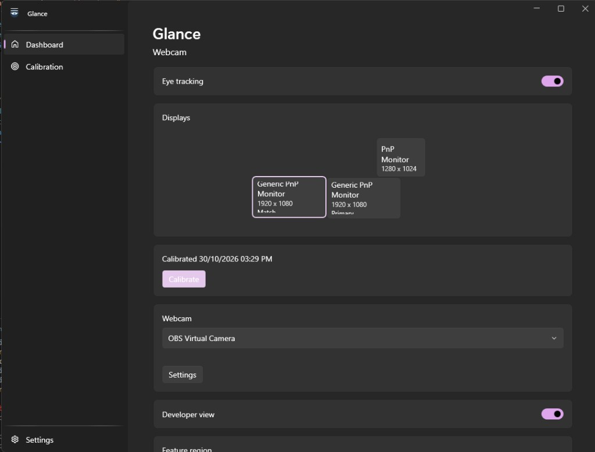

# Glance

[](LICENSE)

Glance is a Windows desktop utility. A webcam watches your eyes, Glance decides which monitor you are looking at, and it moves the cursor there. It then brings forward the topmost window on that monitor and, when it can, returns the keyboard to the last text box you used in that window.

The repository is public. The code is [MIT licensed](LICENSE).



## What it does

- Tracks one face from the webcam and reads where each iris sits in its eye.
- Learns a region for each monitor from five calibration dots: the four corners and the center.
- Moves the cursor when a glance stays on one monitor.
- Activates the frontmost normal window on that monitor. Glance does not force the focus if Windows refuses it.
- Remembers the last editable control in that window and restores it on the way back.
- Shows head yaw, the feature graph, and the raw measurements only in Developer view.

Frames, landmarks, and calibration stay on this computer. Glance does not upload them and it does not send telemetry.

## Run

You need the .NET 9 SDK and the Windows desktop runtime.

```text
dotnet test tests/Glance.Tests/Glance.Tests.csproj
dotnet run --project src/Glance.App/Glance.App.csproj
```

The face detector and the 478-point landmarker are not in git. Download these two files from the `weights` release of [yakhyo/mediapipe-face-mesh-onnx](https://github.com/yakhyo/mediapipe-face-mesh-onnx) and place them in `assets/models`:

- `face_detection_short_range.onnx`
- `face_landmarker_Nx3x256x256.onnx`

Those weights stay under their own Apache-2.0 terms. Glance runs both graphs on the GPU through DirectML when that provider can load them, and on the CPU otherwise.

Settings, the gaze profile, and logs are under `%LOCALAPPDATA%\Glance`. Sign-in startup stays off until you turn it on in Settings.

## Layout

```text
Glance.sln
src/Glance.App          WPF shell, tray, calibration, developer view
src/Glance.Tracking     Webcam, ONNX face pipeline, iris measurement
src/Glance.Core         Calibration, regions, switching
src/Glance.Windows      Displays, cursor, window focus
tests/Glance.Tests
assets/models           Model weights, not committed
docs/dashboard.png      Screenshot used above
math.md                 Geometry notes
```

## License

[MIT](LICENSE). Copyright (c) 2026 SyncFXPro.
